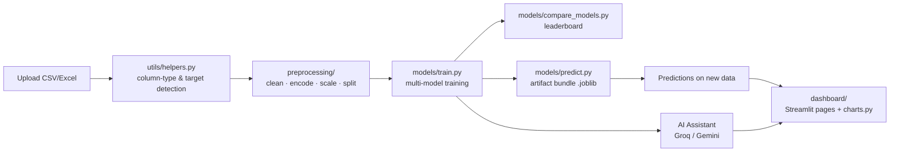

<div align="center">


</div>

## 📌 Overview

At a 24-hour datathon, the real dataset only drops on the day itself, so most of the clock gets eaten by plumbing instead of modeling. SupplySense is a dataset-agnostic AutoML studio: upload any tabular business dataset — retail, supply chain, demand forecasting, risk, churn, finance — confirm the auto-detected target column, and the rest of the pipeline adapts automatically with zero hardcoded column names. It handles profiling, EDA, model training/comparison, predictions, business insights and exportable reports end to end.

## ✨ Features

- 🔍 Auto-detection of column types, target column and problem type (classification / regression / time series) — never by column name
- 📊 Automatic EDA — histograms, boxplots, correlation heatmap, missing-value chart, categorical breakdowns
- 🤖 Train and compare Logistic/Linear Regression, Decision Tree, Random Forest, XGBoost, LightGBM and CatBoost
- 📦 Single artifact bundle (`best_model.joblib`) packaging the fitted cleaner, encoder, scaler and model together
- 🔮 Predictions page to score new CSV/Excel files with the saved model
- 💬 AI Assistant for executive summaries, recommendations and prediction explanations (Groq or Gemini)
- 📈 Business Insights, Dashboard Analytics and CSV/Excel/PDF report exports
- ⚡ CLI alternative (`main.py`) for a quick end-to-end pipeline run outside the UI

## 🛠️ Tech Stack

| Layer | Technology |
|---|---|
| Dashboard |   |
| ML |     |
| AI layer | Groq (default) · Gemini (`google-genai`) |
| Data / IO | pandas · numpy · openpyxl · xlrd · fpdf2 |

## 🏗️ Architecture



## 📂 Project Structure

```
supply-chain/
├── app.py                  # Streamlit entry point (page router)
├── main.py                 # CLI pipeline runner (no UI)
├── requirements.txt
├── models/                 # train.py, predict.py, evaluate.py, compare_models.py
├── preprocessing/          # clean.py, encode.py, scale.py, split.py
├── dashboard/
│   ├── pages/               # one module per Streamlit page
│   ├── components/          # sidebar, uploader, KPI cards
│   └── charts.py
├── utils/                  # helpers.py, config.py, logger.py
├── services/                # LLM provider integrations (Groq, Gemini)
├── data/
│   ├── raw/
│   └── processed/
└── outputs/
    ├── models/
    ├── reports/
    └── figures/
```

## ⚙️ Installation

```bash
git clone https://github.com/Fayaz-2007/supply-chain.git
cd supply-chain

pip install -r requirements.txt
streamlit run app.py
```

Then open the local URL Streamlit prints (typically `http://localhost:8501`).

### Environment variables

The AI Assistant, executive summaries, recommendations and prediction explanations need an LLM API key; everything else (upload, preprocessing, AutoML, predictions, dashboards) works fully without one.

```bash
cp .env.example .env
```

| Variable | Required | Get a key at |
|---|---|---|
| `GROQ_API_KEY` | Yes, for AI features (default provider) | console.groq.com/keys |
| `GEMINI_API_KEY` | Only if you switch the active provider to Gemini in `services/llm_service.py` | aistudio.google.com/apikey |

## 🚀 Usage

1. Go to **Dataset Explorer** and upload a CSV or Excel file.
2. Confirm (or override) the auto-suggested target column, date column and problem type.
3. Explore the data on the **EDA** page — charts are generated automatically for whatever columns exist.
4. On **Model Training**, pick a problem type and one or more models, then Train or Compare Models.
5. **Save Best Model** persists a single artifact bundle for consistent preprocessing at prediction time.
6. Use **Predictions** to score a new file, and **Business Insights / Dashboard Analytics / Reports** to turn results into KPIs and exports.

CLI alternative:

```bash
python main.py --data data/raw/your_dataset.csv --target your_target_column
```

`[Screenshot: EDA page with auto-generated charts]`

`[Screenshot: model comparison leaderboard]`

## 🔮 Future Improvements

- Add more model families (e.g. deep learning baselines) to the registry
- Chronological/time-series-aware cross-validation in `compare_models.py`
- Richer PDF report templates beyond the current `real_report.pdf` baseline
- Persisted run history across datathon sessions

## 👨‍💻 Author

**Fayaz Ahmed**
GitHub: [@Fayaz-2007](https://github.com/Fayaz-2007)
LinkedIn: [fayaz-ahmed-59287631a](https://linkedin.com/in/fayaz-ahmed-59287631a)

<div align="center">


</div>
